<!-- Custom hero card (lives in this repo at assets/hero.svg) -->

  

  
  
  
  
  

 

<!-- ===== Stats row (live) ===== -->

  
  

### 📌 Pinned Repository

  
  
  
  

### 🟪 Contributions this year

  <picture>
    <source media="(prefers-color-scheme: dark)" srcset="https://raw.githubusercontent.com/Rohitsengar02/Rohitsengar02/output/contrib-purple.svg" />
    
  </picture>

  

  

### 🛠️ Skills

  

  <a href="https://github.com/Rohitsengar02?tab=repositories"><b>View Activity →</b></a>

